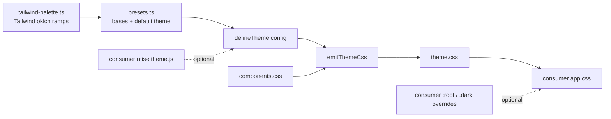

# mise-design-system — Svelte 5 port of the React package design system

Date: 2026-11-04
Status: Approved 2026-11-04

## Basis

mise is based on the author's earlier React design system at 2.23.0, a React
19 + Tailwind v4 + shadcn/Radix library. That repository is the reference for
this port and is only read, never changed.

Throughout this spec, "the React package" means that repository, and
`<react-package>` its local checkout. Read these
first:

| Path in the React package | What it gives the port |
|---|---|
| `CLAUDE.md` | The rules and conventions mise inherits |
| `docs/naming.md` | Names and the prop vocabulary (`tone`, `variant`, `size`); carried over |
| `src/lib/tone.ts`, `src/lib/cn.ts` | Copied as is |
| `src/components/*-variants.ts` | cva class maps, copied verbatim |
| `src/components/<name>.tsx` + `.stories.tsx` | The API and stories each Svelte component reproduces |
| `src/tokens/semantic.ts`, `geometry.ts`, `emit-web.ts` | The theme pipeline, reworked to take a config (see Theming) |
| `src/tokens/palette.ts` | The React package's brand ramps; **not** copied |
| `src/styles/components.css`, `scripts/build-theme.ts` | Copied, then adapted |
| `tests/provenance.test.ts`, `barrel.test.ts`, `theme-parity.test.ts` | The structural suites to port |
| `.storybook/`, `.claude/skills/` | Setup and skills to adapt |

The React package's components started from shadcn/ui new-york. Their Svelte
counterparts in [shadcn-svelte](https://github.com/huntabyte/shadcn-svelte)
(MIT, Svelte 5 + bits-ui) are the second reference: they show how each bits-ui
primitive is wired, its snippet and `bind:` mechanics, and its accessibility
details. The React package decides the API, the props and the classes;
shadcn-svelte only decides the Svelte mechanics (D9).

mise is a separate personal project. It does not depend on the React package,
and nothing in the old product depends on mise.

## Goal

A public, MIT-licensed Svelte 5 component library and theme for operations
dashboards, developed in the repository `jovertical/mise-design-system`
(public from v1) under the package name `@jovertical/mise-design-system`,
published to npm by release-please (D10).

It ports the React design system's component APIs and its theme pipeline, but
not its brand. mise ships its own neutral default theme, and consumer projects
configure their own palette, radius and fonts on top of it.

It is ported in rounds, not in one pass. Each round ends with a review in
Storybook before the next one starts.

## Decisions

| # | Decision | Ruling |
|---|---|---|
| D1 | License | MIT |
| D2 | Package name | `@jovertical/mise-design-system`, public on npm from 1.0.0 (D10) |
| D3 | Repository | `github.com/jovertical/mise-design-system`, base branch `main`. Private for now; made public when the user decides, by v1 at the latest. The agent creates it with `gh repo create --private` in round 0 |
| D4 | Palette | Not the React package's palette. A neutral default theme of its own, which consumers configure (see Theming) |
| D5 | Names of multi-part components | Flat names from the root entry: `Dialog`, `DialogContent`, `DialogTitle`. Names follow React unless a `Diverged:` line says otherwise. `docs/naming.md` carries over. *Amended 2026-11-05 by `2026-11-05-structure-design.md`; it said "names that match React".* |
| D6 | Framework coupling | Components are plain Svelte 5 and never import `$app/*`. SvelteKit is build tooling only, so plain Svelte + Vite apps can consume the package |
| D7 | Stories | `*.stories.svelte` via `@storybook/addon-svelte-csf` |
| D8 | Icons | `@lucide/svelte` only. The React package carries both lucide and tabler; one set is enough here |
| D9 | Svelte reference | shadcn-svelte, for bits-ui wiring and Svelte mechanics only. The React package is the reference for look and behaviour; mise owns its API. *Amended 2026-11-05 by `2026-11-05-structure-design.md`; it said "the React package stays the source of the API".* |
| D10 | Publishing | *Decided 2026-11-09.* release-please on `main`: merging its release PR tags the version, writes `CHANGELOG.md`, creates the GitHub release and publishes to npm with provenance (`.github/workflows/release.yml`). The first release is 1.0.0, from a fresh single-commit history. Until then it said: deferred to v1 |
| D11 | Default theme | `zinc` base, `indigo` brand (see Theming) |

## Package structure

```
mise-design-system/
  package.json
  svelte.config.js
  vite.config.ts                 sveltekit() + tailwindcss()
  tsconfig.json
  biome.json
  LICENSE                        MIT
  README.md                      install, consumer setup, theming
  CLAUDE.md / AGENTS.md
  .ai/guidelines/                architecture, style, theming
  .claude/skills/                adapted from the React package
  scripts/
    build-theme.ts               writes dist/theme.css
  bin/
    mise-theme.js                consumer CLI: config file → theme CSS
  src/
    lib/
      index.ts                   the public entry
      tokens.ts                  the /tokens entry: defineTheme, emitThemeCss, presets
      tokens/
        tailwind-palette.ts      Tailwind v4's default oklch ramps, copied (MIT)
        presets.ts               neutral bases and the default theme
        semantic.ts              semantic token contract (light + dark)
        geometry.ts              radius scale, layout sizes, fonts
        emit-web.ts              theme config → CSS
      styles/components.css      hand-written overrides, appended to theme.css
      utils/
        cn.ts                    copied
        tone.ts                  copied
      components/                one folder per purpose group (docs/naming.md §7)
        actions/
          button/
            button.svelte
            button-variants.ts   copied verbatim from the React package
            button.stories.svelte
        overlays/
          dialog/
            dialog.svelte
            dialog-content.svelte
            dialog-title.svelte
            …
            dialog.stories.svelte
    routes/                      optional playground, not packaged
  .storybook/
    main.ts                      @storybook/sveltekit
    preview.ts
    preview.css
  stories/foundations/           foundation stories: palette, geometry, theming
  tests/
    provenance.test.ts
    barrel.test.ts
    theme.test.ts
    <component>.test.ts
  .github/workflows/
    ci.yml                       svelte-check, biome, vitest, build, publint
```

The React package keeps `src/components/` flat. Svelte cannot: each part of a
multi-part component is its own `.svelte` file, so each component gets a
folder, and each folder sits in a purpose group (added 2026-11-05). The root
entry stays flat (D5).

### `package.json` shape

```json
{
  "name": "@jovertical/mise-design-system",
  "version": "0.0.0",
  "private": true,
  "license": "MIT",
  "type": "module",
  "sideEffects": ["*.css"],
  "svelte": "./dist/index.js",
  "types": "./dist/index.d.ts",
  "exports": {
    ".": { "types": "./dist/index.d.ts", "svelte": "./dist/index.js" },
    "./tokens": { "types": "./dist/tokens.d.ts", "default": "./dist/tokens.js" },
    "./theme.css": "./dist/theme.css"
  },
  "bin": { "mise-theme": "./bin/mise-theme.js" },
  "files": ["dist", "bin"],
  "repository": { "type": "git", "url": "https://github.com/jovertical/mise-design-system.git" },
  "peerDependencies": { "svelte": "^5.0.0", "tailwindcss": "^4.1.0", "tw-animate-css": "^1.0.0" },
  "dependencies": {
    "bits-ui": "…",
    "class-variance-authority": "…",
    "clsx": "…",
    "tailwind-merge": "…",
    "@lucide/svelte": "…"
  }
}
```

Only `svelte`, `tailwindcss` and `tw-animate-css` are peers: the consumer's
own stylesheet imports all three, so they must resolve from the consumer's
install. The React package makes every dependency a peer because two portals it
controls share one install. A public package should install in one step, so
bits-ui, cva, clsx, tailwind-merge and the icons are ordinary dependencies. Heavier, optional ones added in later
rounds (`@tanstack/table-core`, `layerchart`) are decided per round. *Round 4b (2026-11-05): `@tanstack/svelte-table`, `layerchart`, `d3-scale` and `d3-shape` are ordinary dependencies too, for the same one-step install.* *Round 6 (2026-11-05): `vaul-svelte` 1.0.0-next.7, the Svelte 5 line, is one too, for Drawer.*

*Round 6 (2026-11-05), Form:* `formsnap` and `sveltekit-superforms` are optional peers (`peerDependenciesMeta`), and Form ships from its own entry, `mise/form` (`./form` in `exports`), never from the main barrel. superforms imports `$app/*`, so it bundles only inside a SvelteKit app; a plain Vite app (Inertia) fails on `$app/state`. A consumer who never imports `mise/form` installs neither (round 6 plan, R6-5).

Exact versions are filled in at scaffold time. Dependencies are installed by
the user, not by the agent.

## Component API translation

Every prop name, value and default carries over from the React component. Only
the framework mechanics change.

| React | Svelte 5 |
|---|---|
| `className` | `class` |
| `children: ReactNode` | `children: Snippet` |
| Other `ReactNode` props (`icon`, `action`, `description`) | `Snippet` props of the same name. A plain string is also accepted where the React prop was usually a string |
| `asChild` | Dropped. `Button` takes `href` and renders `<a>`. bits-ui parts use its `child` snippet |
| `value` + `onValueChange` | `bind:value`, and `onValueChange` is kept for callers that do not bind |
| `open`, `checked` | `bind:open`, `bind:checked` |
| `ref` | `bind:ref` |
| `onClick` and other handlers | Native lowercase attributes (`onclick`), passed through with the rest props |
| `React.ComponentProps<'button'>` | `HTMLButtonAttributes` from `svelte/elements` |
| `tone`, `variant`, `size`, `iconOnly` | Unchanged, same defaults |
| `data-slot`, `data-variant`, `data-tone`, `data-size` | Unchanged; `components.css` targets them |
| Radix / Base UI | bits-ui |
| cva variant files | Copied verbatim. They are plain TypeScript |

The React rule "a `ReactNode` prop renders in a `div`" becomes "a snippet prop
renders in a `div`".

### Example: `Button`

```svelte
<script lang="ts">
  import type { Snippet } from 'svelte'
  import type { HTMLAnchorAttributes, HTMLButtonAttributes } from 'svelte/elements'

  import { cn } from '../../utils/cn'
  import type { Tone } from '../../utils/tone'
  import { type ButtonSize, type ButtonVariant, buttonVariants, defaultButtonTone } from './button-variants'

  type Props = HTMLButtonAttributes &
    HTMLAnchorAttributes & {
      variant?: ButtonVariant
      /** Defaults to `primary` for `solid` and `link`, `neutral` for the rest. */
      tone?: Tone
      size?: ButtonSize
      /** One glyph and no label: square, round, and it needs an `aria-label`. */
      iconOnly?: boolean
      ref?: HTMLElement | null
      children?: Snippet
    }

  let {
    variant = 'solid',
    tone,
    size = 'md',
    iconOnly = false,
    href,
    disabled,
    ref = $bindable(null),
    class: className,
    children,
    ...rest
  }: Props = $props()

  const resolvedTone = $derived(tone ?? defaultButtonTone(variant))
  const classes = $derived(cn(buttonVariants({ variant, tone: resolvedTone, size, iconOnly }), className))
</script>

{#if href}
  <a
    bind:this={ref}
    href={disabled ? undefined : href}
    aria-disabled={disabled || undefined}
    role={disabled ? 'link' : undefined}
    tabindex={disabled ? -1 : undefined}
    class={classes} data-slot="button" data-variant={variant} data-tone={resolvedTone} data-size={size} data-icon-only={iconOnly || undefined} {...rest}>
    {@render children?.()}
  </a>
{:else}
  <button bind:this={ref} {disabled} class={classes} data-slot="button" data-variant={variant} data-tone={resolvedTone} data-size={size} data-icon-only={iconOnly || undefined} {...rest}>
    {@render children?.()}
  </button>
{/if}
```

React `<Button asChild><a href="/orders">Orders</a></Button>` becomes
`<Button href="/orders">Orders</Button>`. An `<a>` has no `disabled`, so a
disabled link button drops its `href`, sets `aria-disabled` and leaves the tab
order, as shadcn-svelte's button does. `components.css` styles
`[aria-disabled]` like `:disabled`.

### Provenance

Every component opens with a header like the React package's, so the port is
traceable:

```
Origin: the React package 2.23.0 `button.tsx`, itself shadcn/ui new-york `button`
Svelte: shadcn-svelte `button` (href and disabled-link handling)
Diverged: `asChild` dropped for `href`.
```

The `Svelte:` line is present when a shadcn-svelte component was used for the
mechanics, and omitted when it was not.

`tests/provenance.test.ts` enforces it, as it does in the React package.

## Theming

The React package's theme pipeline is kept: a typed token source is emitted
into one `theme.css` with an `@theme inline` bridge, so `bg-primary` resolves
through `:root` / `.dark` and dark mode never freezes. What changes is that the
emitter takes a config instead of reading module constants. The React package's ramps,
fonts and `theme-fixes.md` history do not come over.



### Default theme

- **Base (neutrals):** `zinc` from Tailwind's palette. Selectable alternatives:
  `slate`, `gray`, `neutral`, `stone`.
- **Brand (`--primary`):** `indigo`.
- **Statuses:** `info` sky, `success` emerald, `warning` amber, `critical`
  red. They map to the shared `Tone` exactly as in the React package.
- **Charts:** five Tailwind hues, picked to stay apart from each other and from
  the brand.
- **Fonts:** system stacks, so a public consumer loads nothing by default.
  `--font-sans`, `--font-heading` and `--font-mono` are all configurable.
  Numbers use `tabular-nums` rather than a mono base face. Mono-as-base was
  the React package's identity choice.
- **Radius:** one `--radius` (default `0.625rem`) that derives the scale, as in
  the React package.

Ramp values are written into `theme.css` as literal `oklch()` values copied from
Tailwind v4's default palette (MIT). They are not `var(--color-zinc-…)`
references, because Tailwind may prune theme variables a consumer never uses.

### How consumers configure it

Three levels; each one is optional.

1. **Use the default.** Import the stylesheet:

   ```css
   @import 'tailwindcss';
   @import 'tw-animate-css';
   @import '@jovertical/mise-design-system/theme.css';
   @source '../node_modules/@jovertical/mise-design-system/dist';
   ```

   `tw-animate-css` is a peer dependency, so the consumer installs it next to
   `tailwindcss`. The README says so in its install step.

2. **Override variables in CSS.** No tooling. The semantic tokens are a
   documented contract (`--background`, `--primary`, `--muted`, `--border`,
   `--success`, `--radius`, `--font-sans`, …), and any of them can be
   overridden after the import:

   ```css
   :root { --primary: oklch(0.6 0.15 160); --radius: 0.5rem; }
   .dark { --primary: oklch(0.75 0.13 160); }
   ```

   The `-soft` tints are `color-mix()` of their ink, so they follow
   automatically.

3. **Generate a theme from a config.** For a different base, brand ramp or
   status mapping:

   ```js
   // mise.theme.js
   import { defineTheme } from '@jovertical/mise-design-system/tokens'

   export default defineTheme({
     base: 'stone',
     primary: 'teal',            // a Tailwind hue name, or a custom 50–950 ramp
     status: { warning: 'orange' },
     radius: '0.5rem',
     fonts: { sans: "'Inter', system-ui, sans-serif" },
     light: { '--sidebar': '…' }, // escape hatch for single tokens
     dark: { '--sidebar': '…' },
   })
   ```

   `npx mise-theme mise.theme.js -o src/mise-theme.css` writes a full
   replacement for `theme.css`, which the consumer imports in its place.
   `emitThemeCss(config)` is exported too, for consumers that want it in their
   own build script.

`tests/theme.test.ts` asserts that every semantic token is emitted in both
`:root` and `.dark` for every preset, that the bridge never points at a ramp
step directly, and that a config override reaches the output.

## Tooling

- **Build:** `svelte-package` → `dist/` (`.svelte` + `.d.ts`), then
  `scripts/build-theme.ts` → `dist/theme.css`. `publint` runs in CI so the
  package stays publishable while publishing is deferred.
- **Types:** `svelte-check`.
- **Lint and format:** Biome for `.ts`/`.js`. Biome's Svelte support is
  partial; `.svelte` files use its experimental support if it is reliable at
  scaffold time, and `prettier-plugin-svelte` if it is not. Decided at
  scaffold, recorded in the style guide.
- **Tests:** Vitest + `@testing-library/svelte` in jsdom. The structural
  suites (provenance, barrel, theme) port over; behaviour tests port with their
  component.
- **Storybook:** `@storybook/sveltekit`, `addon-svelte-csf`, `addon-a11y`,
  `addon-docs`, with a light/dark toggle and a theme-preset switcher in the
  toolbar so the theming levels can be checked in the browser. Story copy
  describes generic operations: locations, shifts, orders, stock. Nothing
  product-specific.
- **AI tooling:** `CLAUDE.md` (copied to `AGENTS.md`), `.ai/guidelines/`
  (architecture, style, theming), and `.claude/skills/` adapted from the React
  package: `authors-components`, `changes-tokens`, `git-workflow`,
  `vitest-testing`, `documents-updates`, `writes-clean-code`. The
  `.cursor`/`.github` mirrors and their lint are left out for a personal repo.

## Release

Deferred until v1 (D10). Until then:

- Work lands on `main` in conventional, component-scoped commits, as in the
  React package, so release-please can be added later without rewriting
  history.
- Storybook, run locally, is how each round is reviewed.
- Before v1 the user decides the registry, the npm scope and account, and the
  release automation. `"private": true` comes off then.

## Rounds

Each round ends at a gate: the user reviews in Storybook, and the next round
starts only on an explicit go.

| Round | Contents | Gate |
|---|---|---|
| 0 Setup | `git init` on `main` and `gh repo create jovertical/mise-design-system --private`. Scaffold, tokens and theming (all three levels), `components.css`, Storybook, tests, CI, LICENSE, README, AI tooling. The user installs dependencies | Reviewed together with round 1 |
| 1 Core sample | `Button`, `Badge`, `Card` (+ parts), `Input`, `Label`, `Checkbox`, `Dialog` (+ parts). A plain element, form controls, and one multi-part bits-ui component | **Review package structure, setup, APIs and theming in Storybook** |
| 2 Forms and overlays | `Field`, `InputGroup`, `Textarea`, `Select`, `Switch`, `RadioGroup`, `Tabs`, `Toggle`, `ToggleGroup`, `Tooltip`, `Popover`, `DropdownMenu`, `Sheet`, `AlertDialog`, `Alert`, `Avatar`, toasts (`svelte-sonner`) | Storybook review |
| 3 Dashboard shell | `Sidebar`, `PageLayout`, `PageHeader`, `Breadcrumb`, `SectionTitle`, `EmptyState`, `LoadingState`, `Skeleton`, `Spinner`, `Heading`, `Text` | Storybook review |
| 4 Data | `Table`, the `DataTable` family (`@tanstack/svelte-table` 9; *amended 2026-11-05, it said `@tanstack/table-core`*), `StatTile`, `Metric*`, `DeltaBadge`, `Sparkline`, `Chart` (LayerChart). Split with the user into 4a (metrics and stats) and 4b (tables and charts) | Storybook review |
| 5 Triage | The remaining components, each kept, adapted or dropped. Likely dropped as product-specific: `ProductLogo`, `Address*`, `CategoryIcon*`, `CredentialCard`, `MediaUploader`, peso-bound `CurrencyInput` | Agreed list, then ported in further rounds. Agreed 2026-11-05: `docs/specs/2026-11-05-round-5-triage-design.md` |

## Out of scope

- The `/native` entry and React Native tokens.
- The React package's palette, fonts and `docs/theme-fixes.md` history.
- Any change to the React package itself.
- Moving the old portals to Svelte.
- Publishing to npm, release-please and versioned releases, until v1 (D10).
- Deploying Storybook anywhere; it runs locally.
